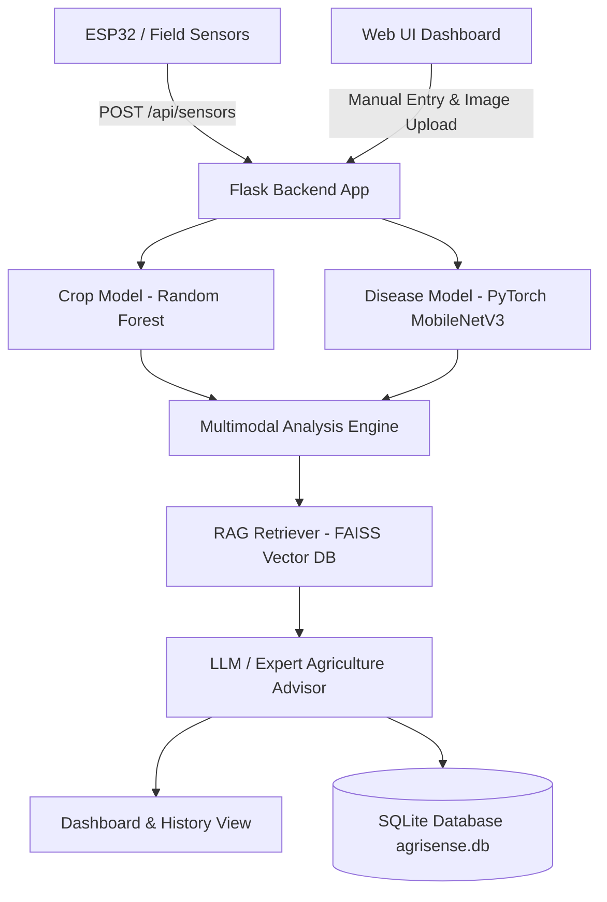

# AGriSense – AI and IoT Based Smart Agriculture System

**AGriSense** is an enterprise-grade, multimodal smart agriculture intelligence platform combining IoT field sensor monitoring, Machine Learning crop recommendation, Deep Learning plant disease diagnosis, RAG knowledge retrieval, and LLM advisory reasoning into a Flask web application with a modern HTML5/CSS3/Vanilla JS dashboard and SQLite persistence.

---

## 🏛️ System Architecture



---

## 📁 Project Directory Structure

```
agrisense/
├── app.py                      # Main Flask application entry point
├── .env.example                # Template for LLM API configuration
├── .env                        # Active environment variables
├── database/
│   ├── agrisense.db            # SQLite database file
│   └── db.py                   # Database schema & CRUD helper functions
├── models/
│   ├── crop_model.pkl          # Trained Random Forest Crop Recommendation Model
│   ├── crop_preprocessor.pkl   # Crop feature scaler / label encoder
│   └── disease_model/
│       ├── disease_model.pth   # PyTorch MobileNetV3 weights
│       ├── class_mapping.json  # 38 PlantVillage class index mapping
│       └── training_metrics.png# Loss & Accuracy plots
├── rag/
│   ├── documents/              # Agricultural PDF/TXT guides
│   ├── ingest.py               # Document chunking & FAISS index builder
│   ├── retriever.py            # SentenceTransformer FAISS retriever
│   └── index/
│       ├── faiss.index         # Vector index
│       └── metadata.json       # Document chunks metadata
├── services/
│   ├── crop_service.py         # Crop recommendation predictor
│   ├── disease_service.py      # Disease detection predictor
│   ├── llm_service.py          # LLM & Expert Advisory engine
│   └── analysis_service.py     # Multimodal analysis orchestrator
├── static/
│   ├── css/styles.css          # Modern dark agricultural UI stylesheet
│   └── js/main.js              # Vanilla JS drag-and-drop, AJAX & DOM renderer
├── templates/
│   ├── dashboard.html          # Main live telemetry dashboard
│   └── history.html            # Historical analysis log table
├── training/
│   ├── dataset_inspection.py   # Dataset analysis & verification script
│   ├── train_crop_model.py     # Crop model training (Random Forest vs XGBoost)
│   └── train_disease_model.py  # PyTorch PlantVillage transfer learning script
└── tests/
    └── run_all_tests.py        # Comprehensive unit & integration test suite
```

---

## 📊 Dataset Setup

Datasets are located at `F:\adithyan\agrisense\data`:
1. **Crop Recommendation CSV**: `F:\adithyan\agrisense\data\crop_recommendation\Crop_recommendation.csv` (2,200 samples across 22 crops, features: N, P, K, temperature, humidity, ph, rainfall).
2. **PlantVillage Dataset**: `F:\adithyan\agrisense\data\plantvillage\PlantVillage` (54,305 images across 38 crop disease & healthy classes).

---

## ⚙️ Installation & Virtual Environment Setup

1. **Navigate to Project Directory**:
   ```bash
   cd C:\Users\Admin\.gemini\antigravity\scratch\agrisense
   ```

2. **Create & Activate Virtual Environment**:
   ```bash
   python -m venv venv
   # On Windows PowerShell:
   .\venv\Scripts\Activate.ps1
   ```

3. **Install Requirements**:
   ```bash
   pip install flask pandas numpy scikit-learn xgboost torch torchvision faiss-cpu sentence-transformers pypdf python-dotenv pillow matplotlib
   ```

---

## 🚀 Model Training & RAG Indexing Commands

Models and RAG indices are pre-trained separately and must NOT train during Flask server startup.

1. **Step 1: Dataset Inspection**:
   ```bash
   python training/dataset_inspection.py
   ```

2. **Step 2: Train Crop Recommendation Model**:
   ```bash
   python training/train_crop_model.py
   ```

3. **Step 3: Train Plant Disease Detection Model**:
   ```bash
   python training/train_disease_model.py
   ```

4. **Step 4: Build RAG FAISS Vector Database**:
   ```bash
   python rag/ingest.py
   ```

---

## 🔑 LLM Advisor Configuration

Configure API keys in `.env`:
```env
LLM_API_KEY=your_gemini_or_openai_api_key_here
LLM_MODEL=gemini-1.5-flash
LLM_BASE_URL=https://generativelanguage.googleapis.com/v1beta
```
*Note: If no API key is provided, AGriSense seamlessly defaults to an offline Expert Agriculture Engine ground-truth rule base.*

---

## 🌐 Running Flask Application

Start the web application server:
```bash
python app.py
```
Open your browser at:
👉 **`http://127.0.0.1:5000`**

---

## 📡 IoT ESP32 Sensor Integration API

ESP32 microcontrollers send field sensor readings via HTTP POST:

**Endpoint**: `POST /api/sensors`
**Headers**: `Content-Type: application/json`

**Sample Payload**:
```json
{
    "soil_moisture": 42.0,
    "temperature": 29.4,
    "humidity": 72.0,
    "ph": 6.4,
    "nitrogen": 48,
    "phosphorus": 31,
    "potassium": 40,
    "rainfall": 12.0
}
```

**Get Latest IoT Telemetry**: `GET /api/sensors/latest`
**Get Sensor History**: `GET /api/sensors/history`

---

## 🧪 Testing

Run the automated unit test suite:
```bash
python tests/run_all_tests.py
```

---

## ❓ Troubleshooting

- **Soil Moisture Displaying 'Not Available'**: Soil moisture is distinct from ambient air humidity. If soil moisture is not provided by sensors, AGriSense displays "Not Available" without substituting air humidity.
- **RAG Index Missing**: Ensure `python rag/ingest.py` has been executed to generate `rag/index/faiss.index`.
- **Image Format Error**: AGriSense supports `.jpg`, `.jpeg`, `.png`, and `.webp` leaf images.
